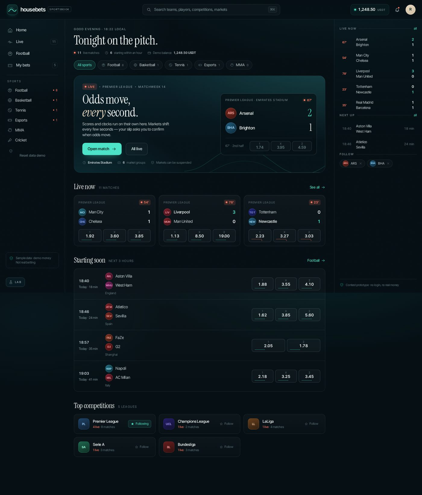

# Housebets Sportsbook — contest prototype

**Live:** https://nothing010101.github.io/housebets/



Clickable prototype for the [Housebets · sportsbook design](https://www.housebets.com/id/contests/sportsbook-design) contest.
Five pages, one shell, sample data. No login, no backend, no real money.

> Note: the starter files (site shell + brand pack) were not available to this account, so the shell, palette and
> typography were derived directly from housebets.com — the wave wordmark, deep marine surfaces and the sea-glass aqua accent.

### Originality

The brief page is public, but no starter-file download is exposed on it (no zip/Drive/GitHub link — only the site's
Masuk/Daftar nav), so no Housebets shell or brand-pack asset is used here.
Everything you see is authored for this entry: the layout, the component set, the inline SVG icon sprite and wave mark,
the typography pairing, the odds/clock engine and all copy. No images, logos or code were taken from housebets.com.
If the official starter pack becomes available, the prototype can be re-skinned onto it without touching the logic.

---

## Run

```bash
# just open index.html, or:
python3 -m http.server 8080
# then http://localhost:8080
```

No build step, no dependencies, no network requests except Google Fonts.
All state (slip, demo balance, bets, follows) lives in `localStorage`.

---

## The five pages

| Page | Route | What is there |
| --- | --- | --- |
| Sports home | `#/` | Live spotlight, Live now, Starting soon, Top competitions, sports nav, search |
| Live | `#/live` | Every match in play, sport + competition filters, live score & clock, empty state → Starting soon |
| Football | `#/football` | 5 leagues, match-result odds on every row, follow a team or competition, "For you" section |
| Match | `#/match/ars-bha` | Arsenal v Brighton live, scoreboard, 6 market groups, odds moving, markets suspended |
| Slip + My bets | `#/bets` | Singles, USDT stakes, odds changed, selection suspended, bet placed / bet failed, cash out |

Every page is linked through the left nav, cards, fixture rows, breadcrumb and the slip.

---

## What actually works

**No silent changes — odds heartbeat.** Every price carries a 60-second movement line at the bottom of its button,
so a moved price is visible even after the flash fades. 1X2 odds on every live match drift every 3.2 seconds with a
green/red flash and a delta arrow. Market groups on the match page move too. "Total goals", "Total cards" and
"Both teams to score" take turns being suspended for 10 seconds — the odds turn striped with a live `Paused · 7s`
countdown, taps are rejected and the slip shows "Reopens in 7s".

**State lab — the judges' tool.** A built-in control panel (the `Lab` pill, bottom-left) that makes every required
state verifiable in seconds instead of waiting for randomness:
- `Odds movement → Paused` freezes prices, `Nudge prices now` applies one synthetic tick (watch the heartbeat move).
- Four buttons pause a specific market for 10 seconds (goals, BTTS, cards, corners) with the countdown on screen.
- `Next bet → Failure / Success` forces the bet-failure or placement path, then returns to Auto.
- `Reset demo` clears local state.
The panel is keyboard/Escape friendly, closes on outside click, and does not touch the product UI or data model.

**Scores & clocks.** Match minutes advance on their own, goals can land, and matches that have not started show a
real countdown that ticks down and flips the fixture to live.

**Bet slip.**
- Tap odds → add to slip. Tap again → remove. Singles only, no multis.
- Per-selection stake (input + 10/25/50/Max chips), potential return updates as you type.
- If odds move by 0.03 or more after you pick, the item shows `Odds moved 1.74 → 1.66` and **Place bet** stays
  locked until you press **Accept** (or **Decline**).
- A suspended selection blocks placement with a clear reason.
- **Place bet** processes for ~1 second. 12% of attempts fail (market closed / odds moved) with an error and no stake deducted.
- On success the demo balance drops, the slip clears and the new ticket animates into My bets.

**My bets.** Open / Settled tabs, cash-out value drifts every 6 seconds, inline cash-out confirmation,
then the status becomes Cashed out and the balance increases.

**Search** (`⌘K` / `Ctrl K` / `/`): teams, players, competitions, markets, matches — deterministic, not AI,
with keyboard navigation and grouped results.

**Follow** a team or competition → their fixtures move into the "For you" section and the "Following only" filter works.

**Responsive.** 1440px: top bar + left nav + side panel + right slip drawer.
390px: bottom tab bar, slip bar above it, 90vh slip sheet with a drag handle, and a Slip / My bets segmented control.

---

## "Tidal" design system

- **Surfaces:** marine ink `#050F14` → `#0B222A`, hairlines `rgba(163,214,219,.10)`, 3.5% grain so it never feels flat.
- **Accents:** aqua `#4BE3C8` (actions, selection), coral `#FF7A63` (live), amber `#F2B45C` (suspended), sand `#E8D9C2` (editorial).
- **Type:** Instrument Serif for headlines and scores (an editorial touch, not a generic dashboard),
  Inter Tight for data with tabular figures, wide-tracked uppercase micro labels.
- **Form:** 8–22px radii, two-level fixture rows, one hairline, no stacked card soup.
- **Motion:** 160–380ms with custom easing; everything is removed under `prefers-reduced-motion`.

---

## Structure

```
index.html            shell: top bar, rail, side panel, bottom bar, drawer, palette, state lab, icon sprite
assets/app.css        design system + all components + heartbeat + lab + 1320/1120/900/420 breakpoints
assets/data.js        teams, competitions, 26 matches, 6 market groups, players, sample bets
assets/app.js         hash router, localStorage store, odds/clock engine, heartbeat history, slip, cash out, search, lab
SUBMISSION.md         copy for the contest form: big idea, tools, page checklist
```

---

## Contest scope

- [x] 5 pages, linked, one shell (top bar, left nav, side panel)
- [x] 390px and 1440px
- [x] Slip on phones: a bar at the bottom
- [x] Front end only, sample data, no login, no real money
- [x] Odds moving, markets suspended, odds changed must be accepted, selection suspended
- [x] Bet placed & bet failed, cash out, open/settled history
- [x] No multis/accumulators, boosts, promos, outrights, stats widgets or AI search
- [x] Extras built for review: odds heartbeat, State lab, market reopen countdowns
